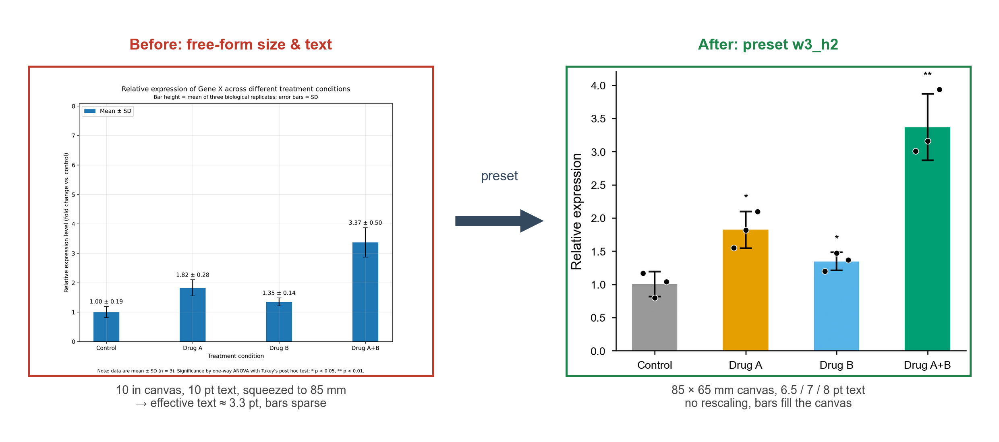
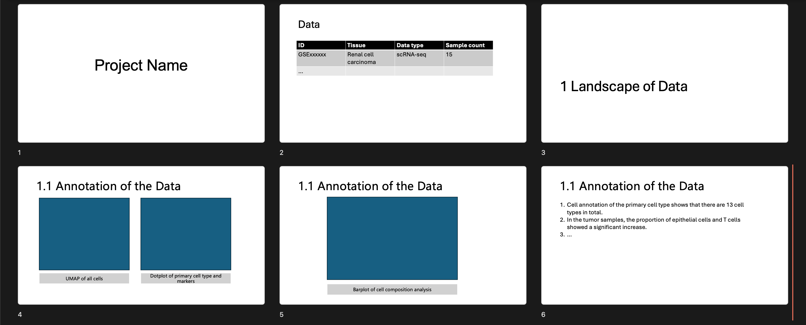

# bioinformatics-copier-template

[](https://github.com/copier-org/copier)

Copier template for bootstrapping a bioinformatics analysis project with:

- [Pixi](https://pixi.sh/) for environment and task management
- [Nextflow DSL2](https://www.nextflow.io/) for workflow orchestration
- generation-time executor selection: **local** or **Slurm**
- a Git-friendly starter layout with updateable Copier answers
- automatic `git init` during `copier copy`

## How to use

This template uses a local Copier context hook via `copier_templates_extensions` and a post-copy task to initialize Git, so you must:

- run Copier with `--trust`
- have `copier-templates-extensions` installed alongside Copier

By default, a generated project is automatically initialized as a Git repository during `copier copy`. If you want to skip that behavior, pass `--skip-tasks`.

### Option 1: one-shot usage with `uvx` (recommended)

This is the easiest way to initialize a project from the GitHub template URL:

```bash
uvx --with copier-templates-extensions --from copier copier copy --trust \
  https://github.com/h4rvey-g/bioinformatics-copier-template.git \
  path/to/destination
```

### Option 2: install Copier + extensions together, then use `copier copy`

If you already have Copier and `copier-templates-extensions` installed in the same environment, you can initialize a project directly with:

```bash
copier copy --trust https://github.com/h4rvey-g/bioinformatics-copier-template.git path/to/destination
```

> [!NOTE]
> Make sure `path/to/destination` is an empty directory, or a directory you intentionally want Copier to populate/update.

### Local render example

```bash
uvx --with copier-templates-extensions --from copier copier copy --trust \
  https://github.com/h4rvey-g/bioinformatics-copier-template.git \
  my-analysis
cd my-analysis
git status
pixi install
pixi run config
pixi run lint
pixi run run
```

### Slurm render example

By default, `Primary author or team name` and `Slurm account/project for billing` are prefilled from the current username.

When `sinfo` is available on the machine running `copier copy`, the template now detects available Slurm partitions and GPU resources and lets the user select them interactively.

```bash
uvx --with copier-templates-extensions --from copier copier copy --trust \
  https://github.com/h4rvey-g/bioinformatics-copier-template.git \
  my-analysis \
  -d has_slurm=true
```

You can still drive Slurm answers non-interactively if needed:

```bash
uvx --with copier-templates-extensions --from copier copier copy --trust \
  https://github.com/h4rvey-g/bioinformatics-copier-template.git \
  my-analysis \
  -d has_slurm=true \
  -d slurm_partition=compute \
  -d slurm_gpu_partition=gpu \
  -d slurm_gpu_gres=gpu:1
```

For Slurm renders, the generated `pixi run run` task uses:

```bash
nextflow run . -profile slurm -resume
```

and the generated Nextflow config enables lenient process caching, which is a safer default on shared HPC filesystems.

If a GPU `--gres` value is selected during generation, the rendered `conf/slurm.config` will set `clusterOptions = '--gres=...'` for `process_gpu` jobs.

## Generated project highlights

A rendered project includes:

- `pixi.toml`
- `main.nf`
- `nextflow.config`
- `conf/base.config`
- `conf/modules.config`
- exactly one executor config: `conf/local.config` or `conf/slurm.config`
- `.copier-answers.yml`
- `AGENTS.md`

The starter workflow reads `assets/samplesheet.csv` and writes small summary files into `results/` for smoke testing.

The rendered project also includes pre-created `data/` and `results/` directories for bulky data and lightweight reviewable outputs, respectively.

## Figure presets

AI-generated plots tend to have tiny text, too many explanatory notes, and elements that look lost on an oversized canvas. Before they go into slides or a multi-panel figure, they usually need another round of resizing.

Rendered projects instead ship a fixed set of canvas sizes and font sizes (`scripts/plot_style.py`). `AGENTS.md` tells the AI to pick from them rather than invent its own, so figures are readable at their final size.



*Same bar chart, same physical size (85 × 65 mm). Left: a 10 in canvas with 10 pt text squeezed down, so text is effectively ~3.3 pt. Right: the `w3_h2` preset at 6.5 / 7 / 8 pt with no rescaling. Reproduce with `python docs/figure_presets_demo.py`.*

Presets are named `wN_hM` (width level N, height level M, both 1–4; 16 combinations):

| Level | Width (mm) | Height (mm) |
| --- | --- | --- |
| 1 | 42 (4 per row) | 40 |
| 2 | 56 (3 per row) | 65 |
| 3 | 85 (2 per row) | 110 |
| 4 | 174 (full width) | 150 |

```python
from plot_style import SUBPANEL_VERSIONS, apply_plot_style

apply_plot_style()  # after any theme setup, before creating figures
fig, ax = plt.subplots(figsize=SUBPANEL_VERSIONS["w3_h2"], layout="constrained")
```

See `template/scripts/README.md` for the full rules.

## Report slide template

Slides built by AI tend to look generic (decorative layouts, long sentences, mostly empty space). The rendered project includes a minimalist, academic-style deck, `report/report_template.pptx`, as the single reference for style and format: layouts, fonts, colors, and positions.



Each template slide carries constraint rules in its **speaker notes**, for example:

- title slide: project name and authors only, no subtitles or footnotes
- section slide: the section title only, no other text
- figure slides: every sub-section shares one slide title; each figure gets a short caption in a grey box that names what the figure is, with no detailed explanation
- summary slide: close every section with a slide that briefly highlights its meaningful results

`AGENTS.md` tells the AI to build from the template, read each slide's notes before using it, and delete the instruction notes from the final deck. When it generates slides with tools such as [OfficeCLI](https://github.com/iOfficeAI/OfficeCLI), the "AI-generated" look is reduced and the content density goes up. OfficeCLI and its `pptx` skill are installed during `copier copy` if missing (the `install_officecli` question).

## Suggested directory naming rules

For generated projects, prefer these directory conventions:

- keep directories shallow, ideally no more than 3 levels deep
- avoid spaces or special characters; use `_` or `-` when separators help readability
- prefer lowercase names for portability across systems
- consider numeric step prefixes such as `101_raw_data/` and `102_qc/`
- keep step prefixes aligned across code, data, and results for the same stage

The rendered destination is also auto-initialized as a Git repository unless Copier is run with `--skip-tasks`.

## Updating an existing generated project

Copier updates work best if the generated project keeps its `.copier-answers.yml` file committed to Git.

From the generated project directory, run either:

```bash
uvx --with copier-templates-extensions --from copier copier update --trust
```

or, if Copier and `copier-templates-extensions` are already installed together:

```bash
copier update --trust
```

Notes:

- run the command from the root of the generated project
- commit or stash local changes first for a cleaner update experience
- if you do not want Copier tasks to run again during update, add `--skip-tasks`
- review any merge conflicts, then re-run checks such as `pixi run config`, `pixi run lint`, and your workflow smoke test

## Notes for template development

- Use the repository root or an absolute template path when re-running `copier copy`.
- If you validate renders under `/tmp`, watch available disk space after `pixi install`.
- Source plan: `plans/bioinformatics-copier-template-plan.md`
